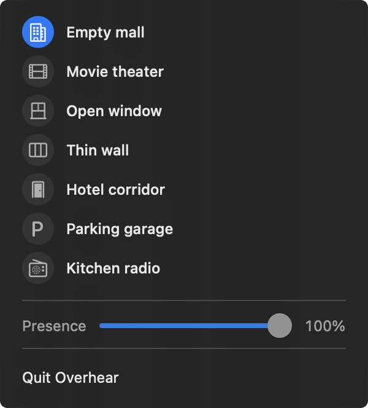

# Overhear

Overhear is a small macOS menu-bar app that places whatever is playing on the Mac inside an imagined acoustic space.



The app includes:

- **Empty mall** — an empty shopping arcade at night
- **Movie theater** — a dark, absorptive auditorium
- **Open window** — music crossing an Italian square
- **Thin wall** — the room next door, just audible
- **Hotel corridor** — music leaking beneath a distant door
- **Parking garage** — bright reflections across concrete decks
- **Kitchen radio** — narrow, worn domestic-speaker reproduction

It uses a macOS Core Audio process tap and processes capture and playback on
the same hardware-clocked callback. No audio is recorded, stored, or sent
anywhere.

## Run

Requires macOS 14.2 or later and Xcode.

```sh
./script/build_and_run.sh --debug
```

The first time an effect is enabled, macOS asks for **Screen & System Audio Recording** permission. If permission was denied, enable Overhear in System Settings → Privacy & Security → Screen & System Audio Recording, then relaunch it.

## Verify

```sh
./script/build_and_run.sh --verify
```
